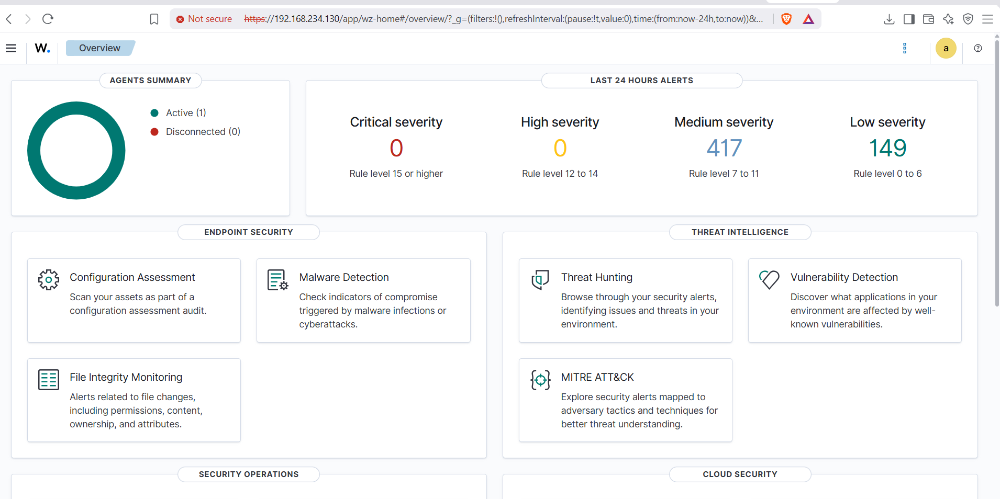

# Wazuh SIEM — Threat Detection & Windows Security Monitoring Lab

  

A hands-on cybersecurity lab exploring how **Wazuh SIEM** centralizes Windows security events, supports threat hunting, and surfaces alerts during a controlled **Remote Desktop Protocol (RDP) authentication test**.

> **Scope:** This is an educational lab performed on systems under my control. The images document observed activity; an alert alone does not establish compromise or prove the exact cause of an event.

## Project objectives

- Set up the Wazuh manager, indexer, and dashboard.
- Register a Windows endpoint with a Wazuh agent and observe collected events.
- Inspect authentication activity in the Wazuh Threat Hunting interface.
- Run an authorized RDP login test with Hydra from Kali Linux.
- Review firewall-drop alerts and security configuration assessment (SCA) findings.

## Tools and environment

| Component | Role |
| --- | --- |
| **Wazuh manager, indexer & dashboard** | Centralized event processing, storage and visualization |
| **Wazuh Windows agent** | Collects security events from a monitored Windows endpoint |
| **Windows endpoint** | Monitored target for authentication and firewall events |
| **Kali Linux** | Lab machine used for an authorized RDP authentication test |
| **Hydra** | Command-line tool used in the controlled RDP login test |
| **VMware Workstation** | Virtualized lab environment |

The screenshots show a Wazuh dashboard at a private lab address and an agent labeled `windows-host`. Private IP addresses are used for demonstration only.

## Lab architecture

The following is a **conceptual illustration** of the attacker, monitored endpoint and SIEM workflow. Exact machine-to-IP mappings and connection ports in the illustration should be verified against the final lab configuration.

**Flow:** Kali Linux performs authorized RDP authentication testing against the Windows lab endpoint → the Windows endpoint records activity → the Wazuh agent forwards relevant events → Wazuh manager processes them → events and alerts are reviewed in the dashboard.

## Implementation and evidence

### 1. Windows agent setup and registration

The lab included Wazuh agent configuration and registration. The screenshots capture agent setup and subsequent active monitoring. Authentication secrets have been redacted from public images.

| Agent setup | Registration |
| --- | --- |
|  |  |

### 2. Verify the monitored environment

The Wazuh overview displays an **active agent**, while the Threat Hunting dashboard shows incoming event data.

| Agent overview | Threat Hunting dashboard |
| --- | --- |
|  |  |

In one captured Threat Hunting view, the dashboard displayed **637 total events**, including **30 authentication failures** and **6 authentication successes** in its selected time window. These are dashboard counts, not a claim that every event originated from the RDP test.

### 3. Controlled RDP authentication test

From Kali Linux, Hydra was used against an RDP service **within the private lab environment**. The terminal screenshot records the test execution and result; credentials are redacted.

### 4. Investigate authentication events

The Wazuh event view shows Windows logon failures and a remote logon alert, including:

- **Rule 60122:** `Logon Failure - Unknown user or bad password` (level 5 in the screenshot).
- **Rule 92657:** A remote logon detection referencing NTLM authentication (level 6 in the screenshot). Its description raises a **possible** pass-the-hash concern; that wording is not proof that pass-the-hash occurred.

The event records provide useful evidence of authentication monitoring. Confirming one-to-one causation between a specific Hydra attempt and a specific Wazuh event would require reviewing the event details, timestamps, source address and associated Windows logon records.

### 5. Review security configuration findings

Wazuh's **Security Configuration Assessment (SCA)** output includes checks based on the **CIS Microsoft Windows 11 Enterprise Benchmark v3.0.0**. The screenshot shows a score-below-30% summary and individual benchmark findings; it does **not** demonstrate remediation.

### Additional observation: firewall activity

Other lab screenshots show **Wazuh rule 4151**, reporting `Multiple Firewall drop events from same source` at level 10. This is an observed firewall-alert scenario; without full event details, it should not be attributed to the RDP test with certainty.

## What I learned

- How Wazuh's main components work together to collect, analyze and display security events.
- How to register and monitor a Windows endpoint using a Wazuh agent.
- How to search and interpret authentication and firewall alerts in a SIEM.
- Why a detection alert must be correlated with underlying evidence before drawing conclusions.
- How SCA findings can identify configuration weaknesses that merit further investigation.

## Limitations and next steps

- This project documents a **lab demonstration**, not a production SOC deployment.
- The screenshots do not establish alert-to-attack causation for every event.
- Additional validation could include exporting redacted event details, documenting the relevant Windows Event IDs, and confirming endpoint and server network configuration.
- A follow-up could document an improved detection rule or an investigation playbook, along with before-and-after testing.

## Security and responsible use

All tests were performed in an authorized private lab. Passwords and Wazuh enrollment/authentication keys must be removed from screenshots before public sharing, and any previously exposed active secrets should be rotated. Do not run credential attacks against systems without explicit permission.

---

**Author:** [Khathera](https://github.com/Khathera)  
**Project type:** Cybersecurity home lab · SIEM · Windows event monitoring · Threat hunting
