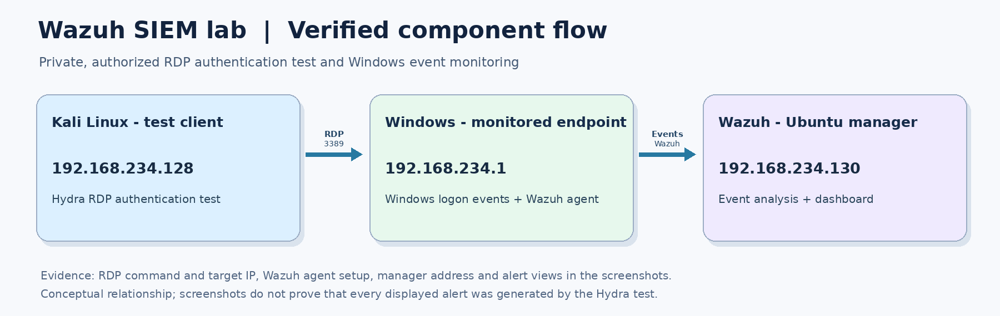
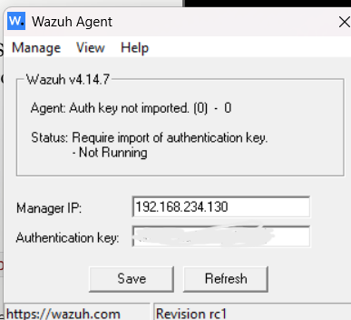
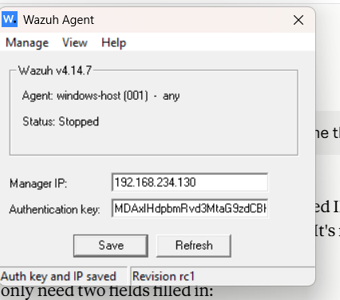
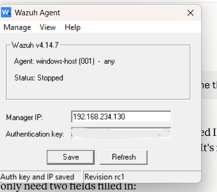
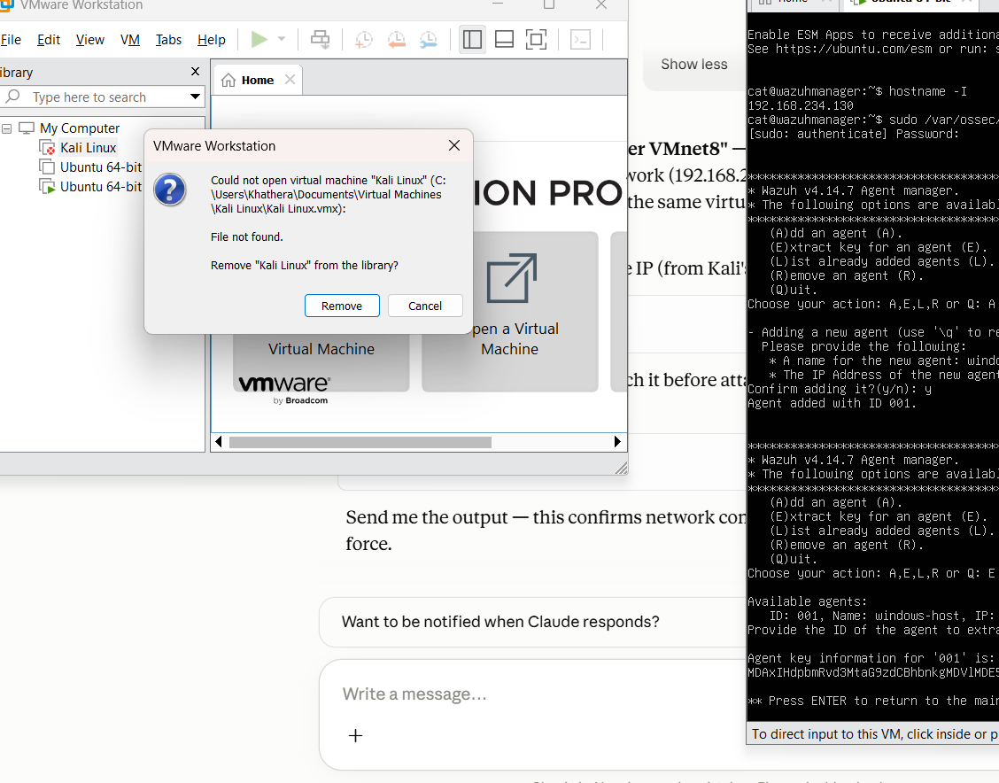
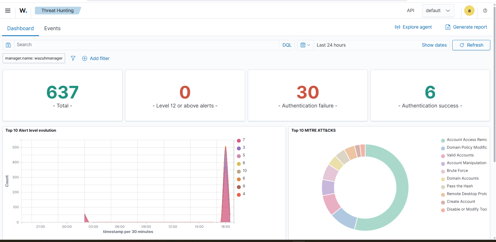
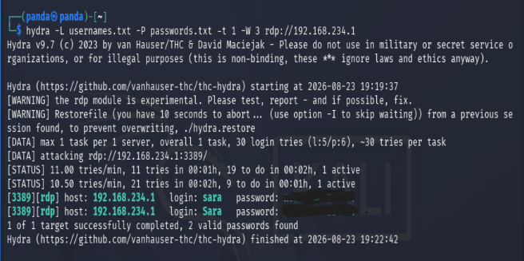
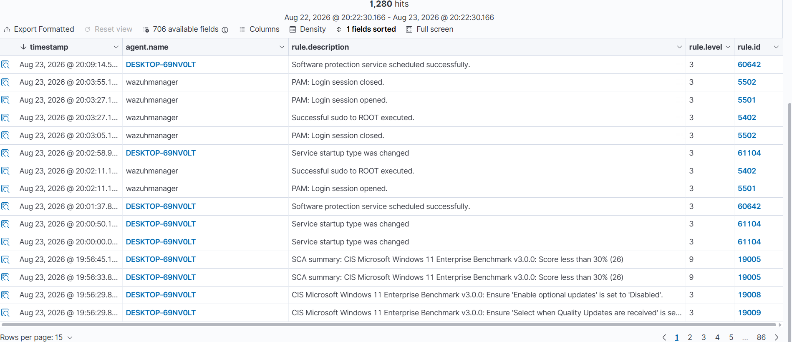
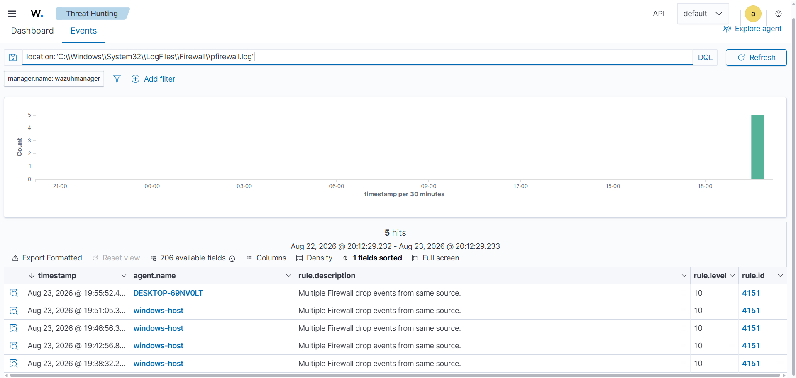
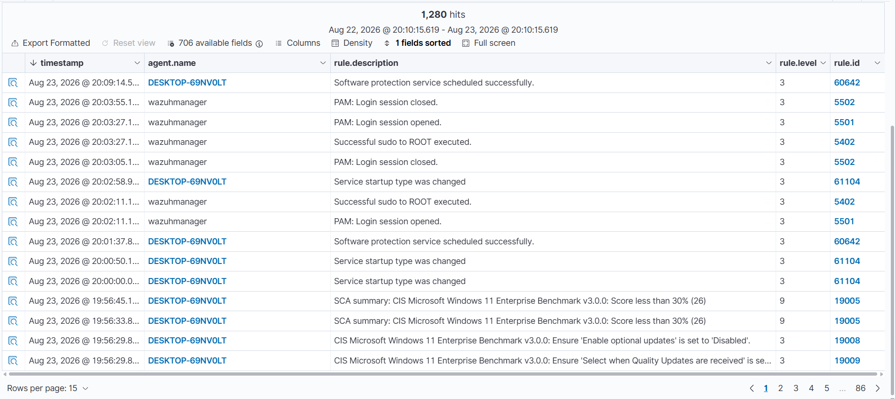

# Wazuh SIEM — Threat Detection & Windows Security Monitoring Lab

  

A hands-on cybersecurity lab exploring how **Wazuh SIEM** centralizes Windows security events, supports threat hunting, and surfaces alerts during a controlled **Remote Desktop Protocol (RDP) authentication test**.

> **Scope:** This is an educational lab performed on systems under my control. The images document observed activity; an alert alone does not establish compromise or prove the exact cause of an event.

## Project objectives

- Set up the Wazuh manager, indexer, and dashboard.
- Register a Windows endpoint with a Wazuh agent and observe collected events.
- Inspect authentication activity in the Wazuh Threat Hunting interface.
- Run an authorized RDP login test with Hydra from Kali Linux.
- Review firewall-drop alerts and security configuration assessment (SCA) findings.

## Tools and environment

| Component | Role |
| --- | --- |
| **Wazuh manager, indexer & dashboard** | Centralized event processing, storage and visualization |
| **Wazuh Windows agent** | Collects security events from a monitored Windows endpoint |
| **Windows endpoint** | Monitored target for authentication and firewall events |
| **Kali Linux** | Lab machine used for an authorized RDP authentication test |
| **Hydra** | Command-line tool used in the controlled RDP login test |
| **VMware Workstation** | Virtualized lab environment |

The screenshots show a Wazuh dashboard at a private lab address and an agent labeled `windows-host`. Private IP addresses are used for demonstration only.

## Lab architecture

The following is a **conceptual illustration** of the attacker, monitored endpoint and SIEM workflow. Exact machine-to-IP mappings and connection ports in the illustration should be verified against the final lab configuration.

**Flow:** Kali Linux performs authorized RDP authentication testing against the Windows lab endpoint → the Windows endpoint records activity → the Wazuh agent forwards relevant events → Wazuh manager processes them → events and alerts are reviewed in the dashboard.

## Implementation and evidence

### 1. Windows agent configuration and registration

The Windows Wazuh agent initially required an authentication key. I registered the `windows-host` endpoint with the Wazuh manager, configured the agent, and verified that the endpoint later appeared as active in the dashboard. Authentication keys shown during configuration have been concealed in the published screenshots.

**Initial agent state — authentication key not yet imported**

**Registration — agent added through the Wazuh manager**

**Agent configured — authentication key saved (agent stopped at capture time)**

### 2. Verify the monitored agent

The Wazuh overview reports **one active agent** at the time of capture.

### 3. Review the Threat Hunting dashboard

Wazuh's Threat Hunting dashboard displayed **637 total events**, including **30 authentication failures** and **6 authentication successes**, within the selected window. These figures describe the dashboard view and are not all attributed to the simulated attack.

### 4. Conduct an authorized RDP authentication test

I used Hydra from Kali Linux to test RDP authentication in the private lab. The screenshot shows the test result, with the recovered password obscured.

### 5. Investigate authentication alerts

The Wazuh event view contains multiple Windows logon failures (**rule 60122**, level 5) and a remote logon detection referencing NTLM authentication (**rule 92657**, level 6). The remote-logon rule warns of a possible pass-the-hash technique; this does **not** independently prove that pass-the-hash occurred.

These events are consistent with authentication-monitoring activity, but proving a direct connection to an individual Hydra attempt requires correlating timestamps, endpoint records, and source addresses.

### 6. Review Windows security configuration findings

The Wazuh event view also showed Security Configuration Assessment (SCA) findings referencing the **CIS Microsoft Windows 11 Enterprise Benchmark v3.0.0**, including a score-below-30% summary. The screenshot demonstrates findings, not remediation.

### 7. Examine firewall drop alerts

Wazuh reported `Multiple Firewall drop events from same source` (**rule 4151**, level 10) on the monitored endpoint. These are firewall alerts; without more event context, they should not automatically be attributed to the RDP test.

## What I learned

- How Wazuh's main components work together to collect, analyze and display security events.
- How to register and monitor a Windows endpoint using a Wazuh agent.
- How to search and interpret authentication and firewall alerts in a SIEM.
- Why a detection alert must be correlated with underlying evidence before drawing conclusions.
- How SCA findings can identify configuration weaknesses that merit further investigation.

## Limitations and next steps

- This project documents a **lab demonstration**, not a production SOC deployment.
- The screenshots do not establish alert-to-attack causation for every event.
- Additional validation could include exporting redacted event details, documenting the relevant Windows Event IDs, and confirming endpoint and server network configuration.
- A follow-up could document an improved detection rule or an investigation playbook, along with before-and-after testing.

## Security and responsible use

All tests were performed in an authorized private lab. Passwords and Wazuh enrollment/authentication keys must be removed from screenshots before public sharing, and any previously exposed active secrets should be rotated. Do not run credential attacks against systems without explicit permission.

---

**Author:** [Khathera](https://github.com/Khathera)  
**Project type:** Cybersecurity home lab · SIEM · Windows event monitoring · Threat hunting
