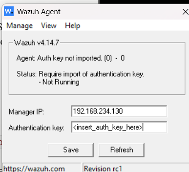
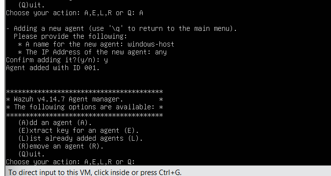
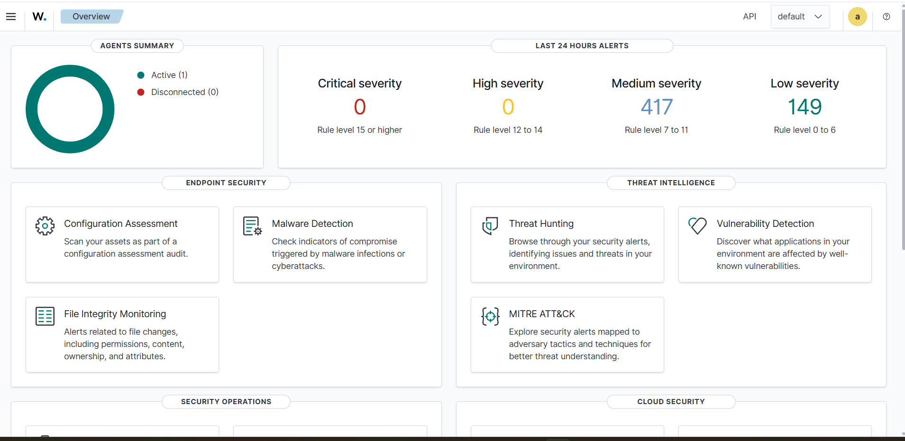
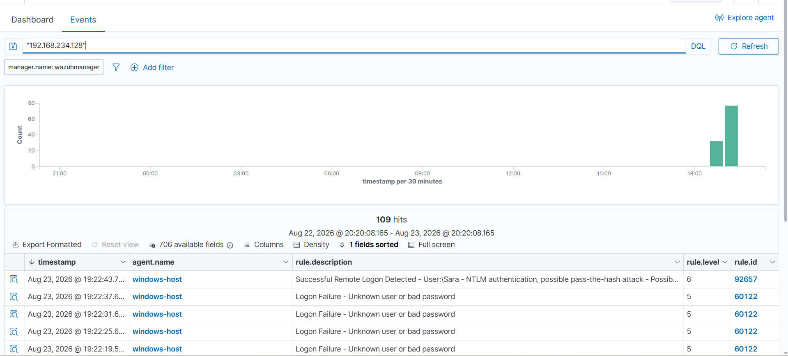

# Wazuh SIEM – Threat Detection and Windows Security Monitoring Lab

  

## Project Overview

This project demonstrates a hands-on cybersecurity lab using **Wazuh SIEM** to monitor Windows security events, investigate suspicious authentication activity, and analyze security alerts.

I configured a Wazuh monitoring environment, connected a Windows endpoint, and performed a controlled **RDP authentication test using Hydra from Kali Linux** to explore how security events appear in the Wazuh dashboard.

The lab also includes Windows Firewall monitoring, threat hunting, and Security Configuration Assessment (SCA).

## Project Objectives

- Configure and register a Windows endpoint with Wazuh SIEM.
- Monitor endpoint activity through the Wazuh dashboard.
- Simulate RDP authentication attempts using Kali Linux and Hydra.
- Investigate Windows authentication events and security alerts.
- Analyze Windows Firewall and security configuration findings.

## Tools and Technologies

| Tool | Purpose |
|---|---|
| Wazuh SIEM | Security monitoring, alert detection, and event analysis |
| Windows | Monitored endpoint and RDP testing |
| Kali Linux | Security testing environment |
| Hydra | RDP authentication testing |
| VMware Workstation | Virtualized lab environment |
| Ubuntu Linux | Wazuh manager hosting |

## Lab Architecture

The lab uses a private VMware network with the following components:

- **Kali Linux:** `192.168.234.128`
- **Windows RDP target:** `192.168.234.1`
- **Wazuh Manager:** `192.168.234.130`

The Windows agent collects security events and forwards them to the Wazuh manager for centralized monitoring and investigation.

## Lab Implementation

### 1. Windows Agent Configuration and Registration

I configured the Wazuh agent on Windows and registered it with the Wazuh manager.

The screenshots show the initial agent configuration and registration of `windows-host` with Agent ID `001`.

### 2. Active Agent Monitoring

After completing the setup, the Wazuh dashboard displayed **one active agent**, confirming that endpoint monitoring was operational.

### 3. Threat Hunting Dashboard

I used the Wazuh Threat Hunting dashboard to explore security events and authentication activity.

The dashboard displayed:

- **637 security events**
- **30 authentication failures**
- **6 authentication successes**

### 4. RDP Authentication Testing with Hydra

I performed a controlled RDP authentication test from Kali Linux against the Windows lab target using **Hydra**.

The test included multiple login attempts and identified a valid credential combination for a lab test account.

### 5. Windows Authentication Event Analysis

I investigated Windows authentication activity in Wazuh following the RDP testing.

The event logs included:

- **Rule 60122:** Windows logon failure – unknown user or incorrect password.
- **Rule 92657:** Remote logon activity using NTLM authentication.

These events provided practical experience in identifying and analyzing authentication-related security alerts.

### 6. Security Configuration Assessment (SCA)

I explored Wazuh's Security Configuration Assessment findings to understand how Windows security settings are evaluated against established benchmarks.

The monitoring results included findings based on the **CIS Microsoft Windows 11 Enterprise Benchmark v3.0.0**, including a security assessment score below 30%.

### 7. Windows Firewall Alert Monitoring

I also investigated Windows Firewall events collected by Wazuh.

The dashboard displayed **five firewall-related events** associated with **Rule 4151 (Level 10)**, reporting multiple firewall drops from the same source.

## Skills Demonstrated

Through this project, I gained practical experience in:

- Wazuh SIEM configuration and endpoint monitoring.
- Wazuh agent registration and management.
- Threat hunting and security event investigation.
- Windows authentication log analysis.
- RDP security testing using Kali Linux and Hydra.
- Windows Firewall alert investigation.
- Security Configuration Assessment using CIS benchmarks.
- Understanding and interpreting security detection rules.

## Conclusion

This lab strengthened my practical understanding of **security monitoring, threat detection, and incident investigation using Wazuh SIEM**.

By combining Windows endpoint monitoring with controlled authentication testing, I gained hands-on experience working with security alerts and investigating suspicious activity in a centralized SIEM environment.

---

**Author:** [Khathera](https://github.com/Khathera)

**Project Focus:** Cybersecurity | SIEM | Threat Hunting | Windows Security | Penetration Testing
